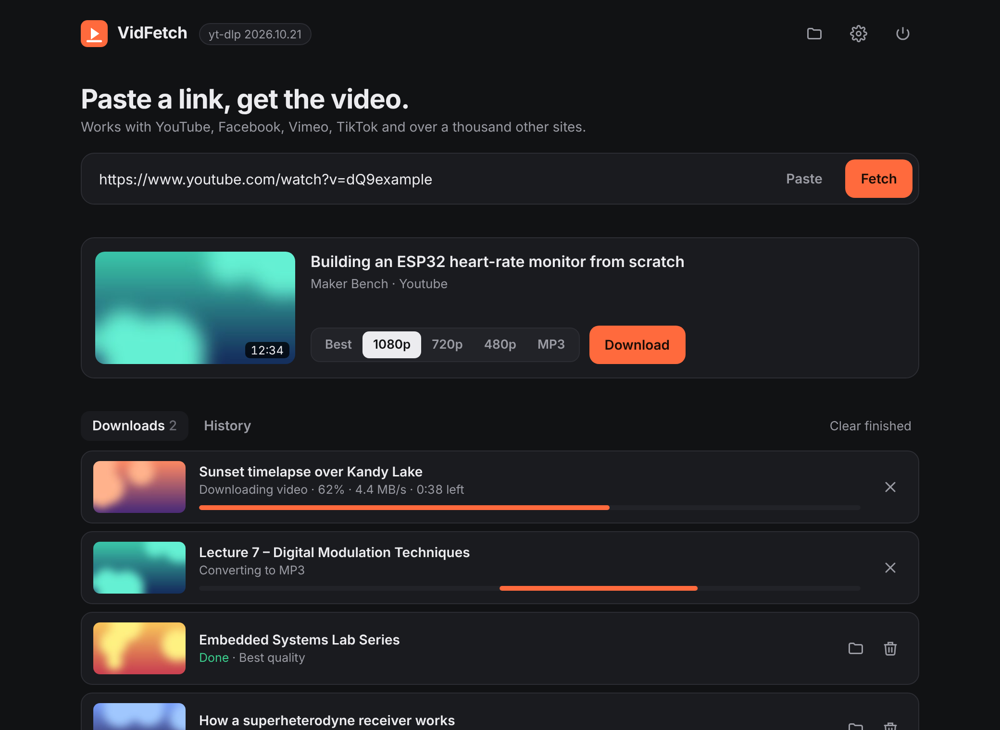

<p align="center"></p>
<h1 align="center">VidFetch</h1>
<p align="center">A free, open-source video downloader for Windows.<br>Paste a link, pick a quality, done. No ads, accounts or tracking.</p>
<p align="center"><a href="https://github.com/SithumAluvihare/vidfetch/releases/latest/download/VidFetch-windows-x64.zip"><b>⬇ Download for Windows</b></a> · <a href="https://sithumaluvihare.github.io/vidfetch">Website</a></p>



## Features

- **Over a thousand sites:** YouTube, Facebook, Instagram, TikTok, Vimeo and more, via [yt-dlp](https://github.com/yt-dlp/yt-dlp)
- **Pick a quality:** Best (up to 4K), 1080p, 720p, 480p, or MP3 audio
- **Download queue:** three at once, with live speed, time left, cancel and retry
- **Playlists:** each one downloads into its own folder
- **History:** shows which files still exist on disk
- **One-click engine updates:** no reinstall needed when a site changes
- **Private:** runs entirely on your PC, with no telemetry

## Install

1. Download `VidFetch-windows-x64.zip` from the [latest release](https://github.com/SithumAluvihare/vidfetch/releases/latest) and extract it.
2. Open `VidFetch.exe`. If Windows SmartScreen appears, click **More info → Run anyway**. The app isn't code-signed yet.

Each release lists the zip's SHA-256 checksum. Check it with `Get-FileHash VidFetch-windows-x64.zip` in PowerShell.

## Run from source

Needs Python 3.10+.

```
git clone https://github.com/SithumAluvihare/vidfetch
cd vidfetch
VidFetch.bat
```

On other systems, run `python -m venv .venv`, then `.venv/bin/pip install -r requirements.txt`, then `.venv/bin/python app.py`.

## How it works

| Part | What it does |
|---|---|
| `app.py` | Local web server on 127.0.0.1, download queue, history (SQLite), yt-dlp self-updater |
| `ui/index.html` | The interface, shown in a native window (pywebview) or the browser |
| `ffmpeg/` (in release) | Merges video and audio, converts to MP3 |
| `deno/` (in release) | JavaScript runtime yt-dlp needs for YouTube |

The API only accepts requests from the app's own page, which holds a random per-session token, so websites can't control it.

## Releasing a new version

Change `VERSION` at the top of `app.py` (for example to `"1.1.0"`) and push to `main`.
GitHub Actions builds the app on Windows, smoke-tests it, and publishes a release with the zip and its checksum. The website's download button always points to the latest release.

## Responsible use

Only download videos you own, that are freely licensed, or that you have permission to save. Respect copyright and each site's terms of service.

## License

MIT for VidFetch's own code. Bundled components keep their own licences; see [THIRD_PARTY_LICENSES.md](THIRD_PARTY_LICENSES.md).
